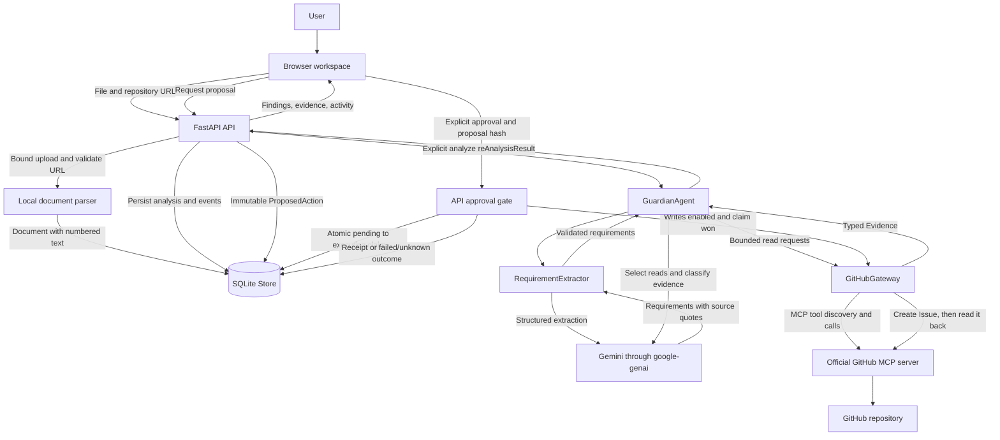
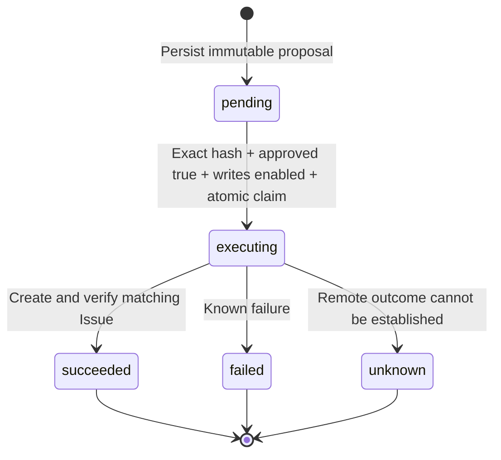

# Architecture

CampusPulse connects assignment requirements to repository evidence and keeps
Issue creation behind approval of an exact proposal. This document describes the
agreed integration design. The source of truth for interfaces is
[CONTRACT.md](CONTRACT.md); `campuspulse/models.py` defines the shared data shapes.
Runtime verification remains pending at the documentation worker's handoff.

## Product data flow



Documents and repository content are untrusted input at every stage. Model output
is also validated. Neither source text nor a model instruction can grant write
authority. The browser receives concise decisions and tool summaries, never private
chain-of-thought or provider credentials.

## Module contracts

| Module | Responsibility and interface |
| --- | --- |
| `parsing.py` | Synchronous `parse_document(bytes, filename) -> Document`; bounded PDF, DOCX, and UTF-8 text parsing. |
| `extraction.py` | `RequirementExtractor(settings).extract(document)`; structured Gemini output, source-quote validation, ambiguity reporting. |
| `github_mcp.py` | `GitHubGateway(settings)` async context manager; `collect(repository, tool, arguments)`, `create_issue(...)`, and `verify_issue(...)`. |
| `agent.py` | `GuardianAgent(...).analyze(document, repository) -> AnalysisResult`; bounded read-tool selection and grounded classification. |
| `api.py` | Upload, authorization, analysis persistence, proposals, approval gate, audit events, and static UI. |
| `storage.py` | Synchronous SQLite `Store`; assignment access, hashed bearer tokens, immutable actions, atomic claims, receipts, and events. |
| `security.py` | Strict repository URL validation, canonical proposal hashing, and safe error messages. |
| `config.py` / `models.py` | Central environment-backed settings and Pydantic schemas; changes require coordination. |
| `static/` | Responsive HTML/CSS/JS; API consumption and safe text rendering. |
| `cloud.py` | Planned Agent Engine wrapper around the real analysis agent, exposing analysis without Issue writes. |

Gemini is responsible for extraction, tool selection, and classification. The
application enforces tool budgets, data validation, authorization, and write state.
GitHub access uses the official remote MCP endpoint configured by
`Settings.github_mcp_url`; it must discover and validate supported tool schemas.
A REST replacement must not be reported as MCP integration.

## Evidence and persistence

The central relationships are:

```text
Assignment = Document + RepositoryRef + optional AnalysisResult
Requirement.source = numbered source reference + verbatim quote
Finding = requirement_id + status + explanation + evidence_ids + recommendation
Evidence = id + tool + source_url + summary + data + retrieved_at
AnalysisResult = requirements + findings + evidence + steps + model + warnings
ProposedAction = requirement_id + repository + title + body + proposal_hash + status
IssueReceipt = number + URL + exact title/body + verified flag
```

`DocumentPage.number` and `SourceReference.page` are one-based. For formats without
stable printed pages, the parser's numbered source sections must be described as
such rather than claimed as original page numbers. Extraction must reject quotes
that do not match the cited source after whitespace normalization.

Every evidence ID in a finding must resolve within the result. Positive and negative
findings need supporting evidence; missing evidence is `unverified`. The eight-call
budget bounds repository exploration, so completeness is not guaranteed.

`AnalysisResult.live` is a field, not independent verification. A live claim needs
actual upstream responses and recorded evidence; test fixtures must be identified
as injected fakes. Audit events and agent steps explain observed actions without
exposing provider errors, secrets, or hidden reasoning.

## Approval state machine



The proposal hash binds repository, title, and body. One atomic claim wins when
approvals race. Repeated approval must not create a second Issue. A timeout after
dispatch can leave the remote result uncertain: retain `unknown`, investigate the
repository, and do not automatically retry. A process interruption can likewise
require manual reconciliation of an executing action. This design prevents local
duplicate dispatch; it does not promise distributed exactly-once delivery.

## HTTP boundary

| Method and route | Contract |
| --- | --- |
| `GET /api/health` | Status, mode, and configured-service booleans, without secrets. |
| `POST /api/assignments` | Multipart `file` and `repository_url`; local parse, returns `{assignment, token}`. |
| `GET /api/assignments/{id}` | Read one assignment. |
| `POST /api/assignments/{id}/analyze` | Analyze and return the saved assignment. |
| `POST /api/assignments/{id}/actions` | `{requirement_id}` creates an immutable proposal. |
| `POST /api/assignments/{id}/actions/{action_id}/approve` | `{proposal_hash, approved: true}` requests execution. |
| `GET /api/assignments/{id}/events` | Read audit events. |

Upload creates the token; subsequent assignment routes require
`X-Assignment-Token`. Unknown and unauthorized IDs both return 404. The token is
stored hashed on the server and held in browser `sessionStorage`. Losing the
plaintext token loses access through this interface.

Errors use `{detail: string}` with 400 for invalid input, 404 for inaccessible IDs,
409 for conflicts, 413 for oversized uploads, 422 for schema validation, 503 for
missing configuration, and 502 for upstream failure. Local development binds to
`127.0.0.1`; no wildcard CORS is part of the contract.

## Deployment and development boundaries

The local FastAPI process serves the browser UI and persists to SQLite. Agent
Engine is a separate cloud target for analysis, not evidence that the UI or database
has been hosted. Cloud execution needs a real project, valid credentials, packaged
dependencies, and a successful invocation of the deployed resource. These remain
unverified until the cloud worker and coordinator record actual results.

Ruflo coordinates ten development roles: architecture, parsing/extraction, GitHub
MCP, Gemini agent, backend, frontend, cloud, storage, QA, and security. The
coordinator integrates isolated worktrees. Codex executors perform the assigned
development work in the current run. Ruflo registration, task execution, local
tests, live services, GitHub delivery, and cloud deployment are separate evidence
categories; none proves the next.

## Definition of done

- All owned changes integrate against the central models and HTTP contract.
- Local tests cover parsing, quote grounding, evidence references, token isolation,
  approval races, uncertain writes, and explicit error behavior.
- The UI is checked on desktop, mobile, and keyboard paths with untrusted text.
- Live analysis records real Gemini and official GitHub MCP responses.
- Any demonstrated Issue write has explicit approval and a matching readback.
- Cloud completion includes the deployed resource name and a successful invocation.
- The final report records exact checks and blockers; it does not substitute mocks
  or worker registration for external verification.
