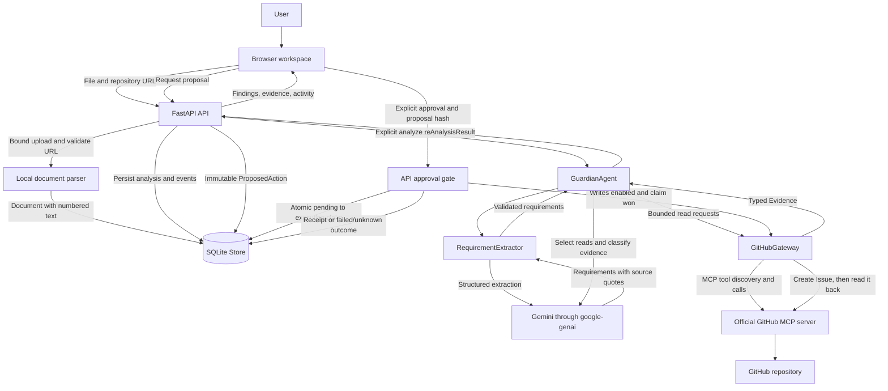
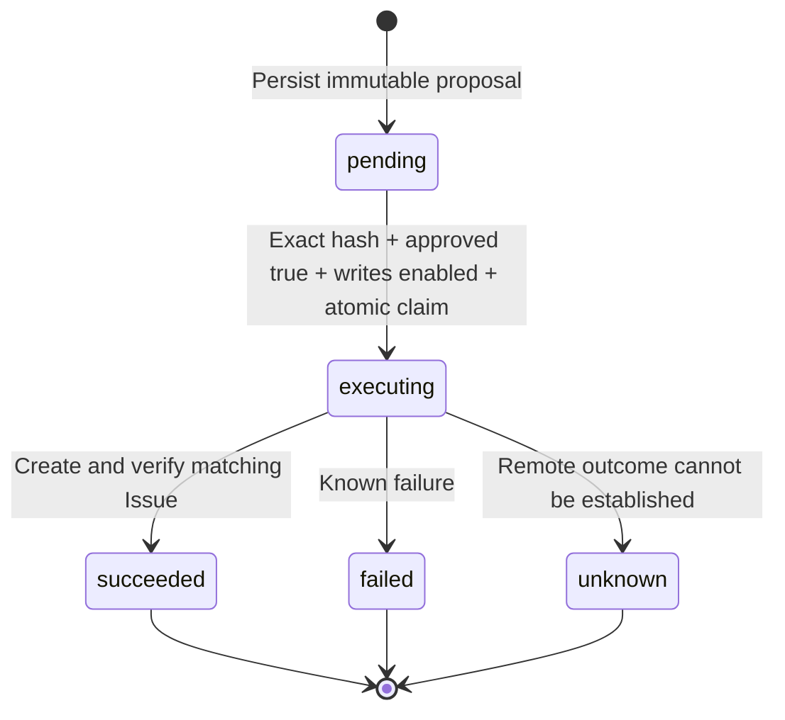

# Architecture

CampusPulse connects assignment requirements to repository evidence and keeps
Issue creation behind approval of an exact proposal. This document describes the
integrated implementation. [CONTRACT.md](CONTRACT.md) defines its interfaces;
`campuspulse/models.py` defines the shared data shapes. Consult
[VERIFICATION.md](VERIFICATION.md) for the current checks and remaining blockers.

## Product data flow



Documents and repository content are untrusted input at every stage. Model output
is also validated. Neither source text nor a model instruction can grant write
authority. The browser receives concise decisions and tool summaries, never private
chain-of-thought or provider credentials.

## Module contracts

| Module | Responsibility and interface |
| --- | --- |
| `parsing.py` | Synchronous `parse_document(bytes, filename) -> Document`; bounded PDF, DOCX, and UTF-8 text parsing. |
| `extraction.py` | `RequirementExtractor(settings).extract(document)`; structured Gemini output, source-quote validation, ambiguity reporting. |
| `github_mcp.py` | `GitHubGateway(settings)` async context manager; `collect(repository, tool, arguments)`, `create_issue(...)`, and `verify_issue(...)`. |
| `agent.py` | `GuardianAgent(...).analyze(document, repository) -> AnalysisResult`; bounded read-tool selection and grounded classification. |
| `api.py` | Upload, authorization, analysis persistence, proposals, approval gate, audit events, and static UI. |
| `storage.py` | Synchronous SQLite `Store`; assignment access, hashed bearer tokens, immutable actions, atomic claims, receipts, and events. |
| `security.py` | Strict repository URL validation, canonical proposal hashing, and safe error messages. |
| `config.py` / `models.py` | Central environment-backed settings and Pydantic schemas; changes require coordination. |
| `static/` | Responsive HTML/CSS/JS; API consumption and safe text rendering. |
| `cloud.py` | `GuardianCloudAgent.async_query(document, repository_url)` wraps the real analysis agent and exposes no Issue-writing method. |

Gemini is responsible for extraction, tool selection, and classification. The
application enforces tool budgets, data validation, authorization, and write state.
GitHub access uses `https://api.githubcopilot.com/mcp/`. The gateway rejects other
endpoint values, discovers tools, checks their schemas and read-only annotations,
and validates arguments before calling them. The model cannot override the selected
repository or call arbitrary MCP methods. No REST fallback substitutes for MCP.

## Evidence and persistence

The central relationships are:

```text
Assignment = Document + RepositoryRef + optional AnalysisResult
Requirement.source = numbered source reference + verbatim quote
Finding = requirement_id + status + explanation + evidence_ids + recommendation
Evidence = id + tool + source_url + summary + data + retrieved_at
AnalysisResult = requirements + findings + evidence + steps + model + warnings
ProposedAction = requirement_id + repository + title + body + proposal_hash + status
IssueReceipt = number + URL + exact title/body + verified flag
```

`DocumentPage.number` and `SourceReference.page` are one-based. PDF references
identify pages. DOCX references identify body paragraphs; TXT and Markdown use
blank-line paragraphs. These paragraph numbers are not rendered page numbers.
Extraction rejects quotes that do not match the cited source after whitespace
normalization.

Every evidence ID in a finding must resolve within the result. Positive and negative
findings need supporting quotations; unsupported or ambiguous findings become
`unverified`. Empty or partial listings do not prove absence. Invalid and failed
calls also consume the eight-call budget, so completeness is not guaranteed.

`AnalysisResult.live` is a field, not independent verification. A live claim needs
actual upstream responses and recorded evidence; test fixtures must be identified
as injected fakes. Audit events and agent steps explain observed actions without
exposing provider errors, secrets, or hidden reasoning.

## Approval state machine



The proposal hash binds repository, title, and body. One atomic claim wins when
approvals race. Repeated approval must not create a second Issue. A timeout after
dispatch can leave the remote result uncertain: retain `unknown`, investigate the
repository, and do not automatically retry. A process interruption can likewise
require manual reconciliation of an executing action. This design prevents local
duplicate dispatch; it does not promise distributed exactly-once delivery.

## HTTP boundary

| Method and route | Contract |
| --- | --- |
| `GET /api/health` | Status, mode, and configured-service booleans, without secrets. |
| `POST /api/assignments` | Multipart `file` and `repository_url`; local parse, returns `{assignment, token}`. |
| `GET /api/assignments/{id}` | Read one assignment. |
| `POST /api/assignments/{id}/analyze` | Analyze and return the saved assignment. |
| `POST /api/assignments/{id}/actions` | `{requirement_id}` creates an immutable proposal. |
| `POST /api/assignments/{id}/actions/{action_id}/approve` | `{proposal_hash, approved: true}` requests execution. |
| `GET /api/assignments/{id}/events` | Read audit events. |

Upload creates the token; subsequent assignment routes require
`X-Assignment-Token`. Unknown and unauthorized IDs both return 404. The token is
stored hashed on the server and held in browser `sessionStorage`. Losing the
plaintext token loses access through this interface.

Errors use `{detail: string}` with 400 for invalid input, 404 for inaccessible IDs,
409 for conflicts, 413 for oversized uploads, 422 for schema validation, 503 for
missing configuration, and 502 for upstream failure. Local development binds to
`127.0.0.1`. The request guard checks an exact `ALLOWED_HOSTS` list and rejects
cross-origin mutations. Default hosts are `localhost`, `127.0.0.1`, and `[::1]`;
there is no wildcard CORS. API responses use `Cache-Control: no-store`. These
controls do not provide a multi-user identity or repository authorization system.

## Deployment and development boundaries

The local FastAPI process serves the browser UI and persists to SQLite. The cloud
wrapper separately exposes `async_query` on an Agent Engine `reasoningEngines`
resource. It constructs the real `GuardianAgent` at runtime, uses the runtime's
Google identity, disables dotenv/API-key loading, and forces GitHub writes off.

`scripts/deploy.py` uses the pinned `google-cloud-agentplatform[agent_engines]==2.5.0`
package and `agentplatform.Client(...).runtimes.create/get`. It packages an explicit
allowlist of nine Python source files and `requirements-cloud.txt`, with a Secret
Manager reference for the GitHub token. Credentials, databases, Git metadata,
frontend assets, and local agent objects are not included. The optional Dockerfile
serves the local web app; it does not deploy this cloud runtime.

The [recorded dry run](../artifacts/cloud-dry-run.json) contacted no cloud service
and checked no credentials. Project `campusgdg-511817` is supplied, but account
authentication, ADC, and IAM access still block cloud deployment and invocation.
Local Gemini uses the separately configured Developer API key.
See [DEPLOYMENT.md](DEPLOYMENT.md) for the login, runtime identity,
secret-access, source-deployment, and invocation steps. A deployed resource alone
would not prove that the UI, SQLite, or external analysis is operational.

Exactly ten native Codex workers ran the assigned development roles: architecture,
parsing/extraction, GitHub MCP, Gemini agent, backend, frontend, cloud, storage, QA,
and security. Ruflo 3.56.10 coordinated their agent/task records and isolated
worktrees, with at most three workers active at a time. Initial Claude Code
attempts failed because OAuth had expired; those failures are not implementation
execution. The [task manifest](../artifacts/swarm-manifest.json) and
[event log](../artifacts/ruflo-events.jsonl) link the development records.

Ruflo registration, executor work, offline checks, live services, GitHub delivery,
and cloud deployment remain separate evidence categories. Official MCP repository,
file, Issues, and CI reads have [live evidence](../artifacts/live-github-mcp.json);
that does not establish a successful Gemini analysis or Issue write.

## Definition of done

These are acceptance gates, not a statement that all are complete. Final status
belongs in [VERIFICATION.md](VERIFICATION.md); detailed test and security scope
belong in [TESTING.md](TESTING.md) and [SECURITY.md](SECURITY.md).

- All owned changes integrate against the central models and HTTP contract.
- Local tests cover parsing, quote grounding, evidence references, token isolation,
  approval races, uncertain writes, and explicit error behavior.
- The UI is checked on desktop, mobile, and keyboard paths with untrusted text.
- Live analysis records real Gemini and official GitHub MCP responses.
- Any demonstrated Issue write has explicit approval and a matching readback.
- Cloud completion includes the deployed resource name and a successful invocation.
- The final report records exact checks and blockers; it does not substitute mocks
  or worker registration for external verification.
